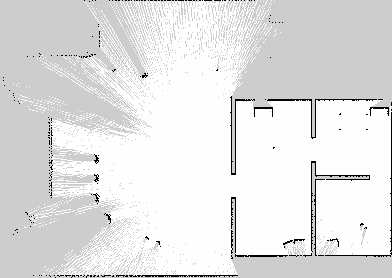

# ARES – Autonomous Robotic Exploration and Reconnaissance System
### Project Synopsis

**Student:** Shambavi H B — B.E. Robotics & AI, Dayananda Sagar College of Engineering, Bengaluru
**Duration:** 11 Nov 2026 – 26 Nov 2026  **Status:** Completed / Demonstrated (simulation)
**Code:** https://github.com/shambavibaswanth/ares  **Demo video:** https://youtu.be/PEWAGG-yhOc

---

## 1. Problem Statement
Entering unknown or hazardous buildings (collapsed structures, fires, chemical leaks, hostile areas) puts people at risk. A small autonomous ground robot that can go in first, map the space, check every room and come back safely reduces that risk.

## 2. Objective
Design and simulate an unmanned ground vehicle (UGV) that can:
- enter an unknown building and build a map in real time,
- navigate through **every room** without human control,
- avoid obstacles and collisions, and detect objects with a camera,
- recover by itself when stuck, and
- return safely to its starting point.

## 3. System Architecture

| Layer | Components |
|---|---|
| Robot model | URDF/Xacro, differential drive, tuned wheel friction |
| Sensors | 360° LiDAR, RGB camera, IMU, 3 ultrasonic sensors, wheel odometry |
| Mapping | SLAM Toolbox (online, async) |
| Navigation | Nav2 – NavFn global planner, DWB local controller, rectangular-footprint costmaps |
| Perception | YOLOv8n object detection fused with LiDAR range |
| Autonomy | Custom Python nodes: obstacle avoidance, self-rescue (un-stick), multi-room missions |
| Simulation / Visualisation | Gazebo Classic 11 custom "recon site" world, RViz 2 |

**Pipeline:** Sensors → SLAM (map + pose) → Nav2 (path planning + control) → `/cmd_vel` → robot; perception and self-rescue run alongside and intervene when needed.

## 4. Simulation Environment
A 22 m × 14 m compound containing a three-room building — **lobby, office and back room** — connected by narrow doorways, with furniture and obstacles from the Gazebo model library.

## 5. Sensor Performance (measured)

| Sensor | Rate |
|---|---|
| LiDAR | 10 Hz |
| IMU | 100 Hz |
| Wheel odometry | 50 Hz |
| Camera | 13–18 Hz |
| Ultrasonic (×3) | 10 Hz |

## 6. Results – Autonomous All-Rooms Mission

| # | Leg | Time (s) | Distance (m) |
|---|---|---|---|
| 1 | Outside the door | 11.4 | 2.80 |
| 2 | Lobby | 11.1 | 2.67 |
| 3 | Lobby, by office door | 9.9 | 2.43 |
| 4 | Office | 8.3 | 1.98 |
| 5 | Office, by back-room gap | 9.2 | 2.20 |
| 6 | Back room entrance | 7.8 | 1.86 |
| 7 | Back room centre | 8.7 | 2.07 |
| 8 | Back-room gap (return) | 14.9 | 3.25 |
| 9 | Office (return) | 8.7 | 2.14 |
| 10 | Lobby door (return) | 8.3 | 1.99 |
| 11 | Lobby (return) | 9.9 | 2.44 |
| 12 | Outside the door (return) | 11.0 | 2.66 |
| 13 | Home | 12.0 | 2.96 |
| | **Total** | **131 s** | **31.5 m** |

**13/13 waypoints reached · all 3 rooms visited · returned home · 0 collisions · 0 self-rescues needed.**

Additional tests: reactive exploration covered 232 of 280 m² with 0 collisions; the self-rescue routine escaped all 4 test traps without contact.

### SLAM map built during the mission

## 7. Tools & Technologies
ROS 2 Humble · Ubuntu 22.04 · Gazebo Classic 11 · Nav2 · SLAM Toolbox · YOLOv8 (Ultralytics) · OpenCV · Python · RViz 2 · Git/GitHub

## 8. Limitations
- Simulation only; not yet tested on hardware.
- YOLO runs on CPU, so detection rate is limited.
- Object-aware avoidance works only within the camera's field of view.

## 9. Future Work
- Build a physical prototype (Raspberry Pi 5 / Jetson, RPLIDAR, encoder motors) — est. ₹75,000.
- Android app for remote monitoring and manual override.
- GPU-accelerated detection; thermal camera for search-and-rescue.
- Multi-robot cooperative exploration.

## 10. Applications
Search and rescue · defence reconnaissance · industrial and hazardous-site inspection · warehouse and indoor mapping.
